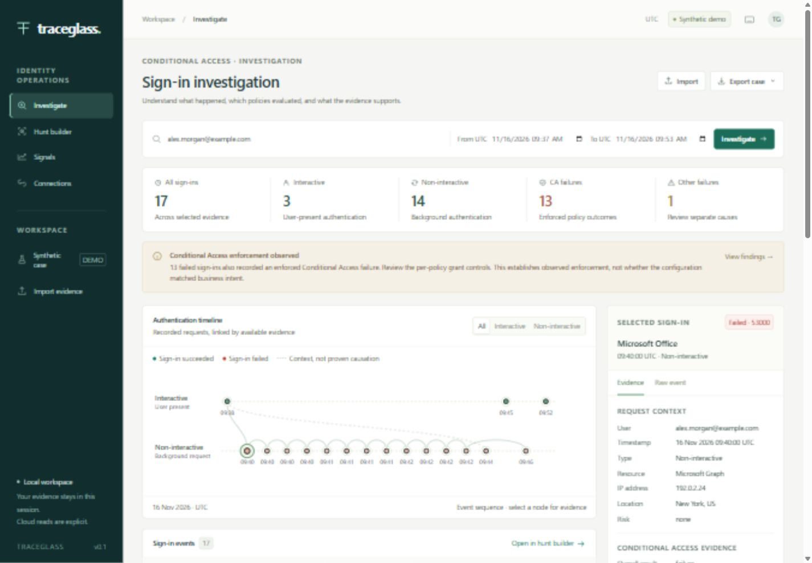

# Traceglass

**An evidence-led workspace for Microsoft Entra Conditional Access investigations.**

Traceglass puts interactive and non-interactive sign-ins on one investigation timeline, explains recorded policy outcomes, and keeps evidence references attached to findings. Use the same analysis engine from a local HTML interface, the terminal, or a VS Code task. A visual KQL builder supports related identity hunts.



This is a working **v0.1 local analyst foundation**, not a production-certified enterprise service. Offline investigations run immediately. Live connectors are implemented and covered by mocked tests; tenant authentication, permissions, and generated KQL still require validation in your environment. There is no LLM or autonomous agent in this version.

## Start in one minute

An optional GitHub Actions workflow is provided at [docs/github-actions-ci.yml](docs/github-actions-ci.yml). Copy it to `.github/workflows/ci.yml` using a GitHub session with workflow permission to enable CI.

Install Node.js 22 or later, open this directory, and run:

```powershell
node src/cli.js serve
```

Open [http://127.0.0.1:4318](http://127.0.0.1:4318). The app starts with a clearly labeled synthetic case. **No dependency installation, Microsoft account, or tenant access is needed for demo and offline use.** The demo uses `example.com` identities and documentation-only IP ranges.

For VS Code, open [traceglass.code-workspace](traceglass.code-workspace). Use **Terminal → Run Task → Traceglass: Web UI**, or select **Traceglass: Web server** in Run and Debug. Tasks also launch a demo investigation, generate KQL, and run tests.

The server binds to `127.0.0.1`. Keep it local to the analyst's machine; it is not a shared web service.

## What works

- **User investigation:** search loaded evidence by UPN, display name, or user ID; scope by time and sign-in type; inspect event details and original records.
- **Visual event flow:** compare interactive and background sign-ins, recorded outcomes, resource changes, and shared identifiers. Shared-identifier associations are distinguished from nearby events that provide context only.
- **Conditional Access evidence:** separate enforced failures, report-only failures, successful evaluations, and unavailable policy details. Findings cite event IDs and explain their limits.
- **Failure concentrations:** view five-minute CA failure buckets and sample-relative spike candidates with explicit baseline and minimum-volume requirements.
- **KQL hunting:** combine allowlisted filter blocks with drag-and-drop or keyboard controls; generate user, risky sign-in, IP/CIDR, CA failure, spike, distinct-combination, and recurring-pattern queries across both sign-in tables.
- **Data access:** import Graph/Log Analytics JSON or read through the Graph and Log Analytics connectors. Cloud reads happen only when requested.
- **Evidence exports:** save normalized events, original observations, findings, and a SHA-256 integrity digest as JSON, or export a readable Markdown incident report.

Local query preview applies supported predicates to the loaded records. **KQL aggregation executes in Log Analytics**; local preview does not pretend to run a Kusto engine. The query editor is a generated query preview, not an arbitrary script execution surface.

The live risky-sign-in preset filters `RiskLevelDuringSignIn` for low, medium, or high risk. It is not a complete inventory of later offline risk detections or risky-user state changes.

## A first investigation

1. Open the synthetic case and search for `alex.morgan@example.com`.
2. Inspect the successful interactive event at **09:38:04 UTC on November 16, 2026**.
3. Compare the background requests at **09:40–09:42 UTC**. Their compliance policy result is `failure`, while the pilot network policy is `reportOnlyFailure`.
4. Inspect the separate invalid-password event and the record with missing policy details. They need different explanations.
5. Export the evidence and use its event IDs to support the incident narrative.

The sample is intentionally synthetic. Its device and policy changes illustrate how evidence is presented; they are not a model of every real token flow.

## Terminal workflows

```powershell
# Analyze the synthetic case
node src/cli.js investigate --demo --user alex.morgan@example.com

# Analyze an existing JSON export
node src/cli.js investigate --file data/signins.json --user person@example.com

# Export a readable incident report
node src/cli.js investigate --file data/signins.json --format markdown --out exports/incident.md

# Export evidence with its integrity digest
node src/cli.js investigate --file data/signins.json --format json --out exports/evidence.json

# Inspect sample-relative failure spikes
node src/cli.js spikes --file data/signins.json

# Generate KQL without executing it
node src/cli.js query --preset risky --hours 24
node src/cli.js query --preset ip --cidr 203.0.113.0/24 --mode distinct
node src/cli.js query --preset patterns --mode patterns --hours 24

# Read supported commands and configuration status
node src/cli.js --help
node src/cli.js doctor
```

Use `--file -` for JSON from stdin. Investigation output supports `text`, `json`, and `markdown`. Supply explicit timezone-qualified bounds, for example `--start 2026-11-16T09:00:00Z --end 2026-11-16T11:00:00Z`. Times in reports are UTC.

For saved query specifications:

```json
{
  "preset": "ip",
  "hours": 24,
  "limit": 1000,
  "mode": "patterns",
  "cidr": "192.0.2.0/24",
  "groupBy": ["IPAddress", "AppDisplayName"],
  "filters": [
    { "field": "IsInteractive", "operator": "eq", "value": false },
    { "field": "ConditionalAccessStatus", "operator": "eq", "value": "failure" }
  ]
}
```

Save the specification under ignored `data/`, then run `node src/cli.js query --spec data/hunt.json`. Filters use AND semantics. Supported operators are `eq`, `neq`, `contains`, `startsWith`, `in`, and `cidr`; CIDR is limited to the IP field. Numeric time/row limits and grouping fields are validated. The checked-in [queries](queries/) directory contains examples.

## Connect live data

```powershell
npm ci
Copy-Item .env.example .env
```

Choose your authentication mode in `.env`, then start with `npm start`. Supported modes are Azure CLI, delegated interactive browser, device code, client secret, managed identity, and offline. Tokens stay in the backend credential implementation. See [CONNECTORS.md](docs/CONNECTORS.md) for app registration, consent, roles, workspace access, and exact configuration.

```powershell
# After configuring authorized read access
node --env-file-if-exists=.env src/cli.js collect --source graph --user person@example.com --hours 24 --out exports/case.json
node --env-file-if-exists=.env src/cli.js collect --source log-analytics --workspace YOUR-WORKSPACE-GUID --user person@example.com --hours 24 --out exports/case.json
node --env-file-if-exists=.env src/cli.js query --preset risky --hours 24 --run --workspace YOUR-WORKSPACE-GUID
```

Log Analytics/Sentinel is the preferred path for a durable deployment, with both `SigninLogs` and `AADNonInteractiveUserSignInLogs` exported. Graph deliberately uses **beta** with explicit interactive and non-interactive filters: beta is subject to change and Microsoft does not support it for production applications. The app surfaces that limitation instead of silently dropping a sign-in category. [Microsoft Graph beta sign-in documentation](https://learn.microsoft.com/en-us/graph/api/signin-list?view=graph-rest-beta).

## What the evidence can establish

A failed sign-in plus an enforced CA failure supports **“Conditional Access enforcement was observed.”** It does not establish that the policy matched business intent. A successful interactive event does not guarantee a later background request will succeed, and temporal proximity does not prove token lineage.

CA success is distinct from overall sign-in success. Report-only policy failures do not enforce a denial. Missing CA permissions can cause policy details to be omitted, so missing details cannot be interpreted as “no policy applied.” [Troubleshooting Conditional Access](https://learn.microsoft.com/en-us/entra/identity/conditional-access/troubleshoot-conditional-access), [report-only behavior](https://learn.microsoft.com/en-us/entra/identity/conditional-access/concept-conditional-access-report-only), [policy visibility requirements](https://learn.microsoft.com/en-us/graph/api/signin-list?view=graph-rest-beta).

Traceglass prefers `CreatedDateTime` for event chronology. `TimeGenerated` can reflect receipt/publication time. Some non-interactive IP fields represent the original token issuance location, and portal entries can aggregate multiple similar events. These limitations matter when comparing timing, volume, or locations. [Interactive logs](https://learn.microsoft.com/en-us/entra/identity/monitoring-health/concept-interactive-sign-ins), [non-interactive logs](https://learn.microsoft.com/en-us/entra/identity/monitoring-health/concept-noninteractive-sign-ins).

## Verification and boundaries

```powershell
npm test
npm run check
```

Tests cover evidence normalization and attribution, unknown values, correlation boundaries, report-only handling, conflicting observations, KQL input validation, IP ranges, connector pagination and partial responses, and local HTTP boundaries. Syntax checks cover application and test JavaScript. Tests do not substitute for live tenant/KQL validation.

This version has no historical policy snapshots, tenant-wide baseline service, multi-user authorization, durable case database, background monitoring, automatic remediation, or AI provider integration. See [ARCHITECTURE.md](docs/ARCHITECTURE.md) and [ROADMAP.md](docs/ROADMAP.md) for extension points and the work required for enterprise deployment.

## Public repository hygiene

Source code and synthetic fixtures may be public. **Real sign-in data, case exports, populated environment files, credentials, and authentication captures must stay private.** `.gitignore` excludes `data/`, `exports/`, `.env*` except the template, credential formats, logs, and `artifacts/`; ignore rules do not remove files that were already tracked. Review staged content before pushing. See [SECURITY.md](SECURITY.md) and [CONTRIBUTING.md](CONTRIBUTING.md).

MIT licensed. Traceglass is an independent project and is not affiliated with or endorsed by Microsoft.
